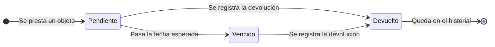
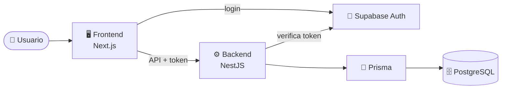

<div align="center">

<h1>🤝 PrestaFácil</h1>

<h3>Lleva el control de lo que prestas.</h3>

<p>
Registra tus objetos, sabe quién los tiene<br>
y cuándo te los devuelven, todo en un solo lugar.
</p>

<p>


</p>

<p>


</p>

<p>
<a href="#-qué-puedes-hacer"><b>Funciones</b></a> ·
<a href="#-ciclo-de-un-préstamo"><b>Ciclo</b></a> ·
<a href="#️-arquitectura"><b>Arquitectura</b></a> ·
<a href="#-empezar-en-local"><b>Instalación</b></a> ·
<a href="#-equipo"><b>Equipo</b></a>
</p>

</div>

---

## 💡 ¿Qué es?

¿Cuántas veces has prestado algo y no recuerdas quién lo tiene? **PrestaFácil** reemplaza las notas sueltas y la memoria por un registro simple: guardas tus objetos, creas un préstamo cuando los entregas y lo cierras cuando vuelven. Si una devolución se pasa de fecha, la app lo marca.

> [!NOTE]
> La app **registra** la información. La entrega y recepción física del objeto ocurren por fuera del sistema.

<table>
<tr>
<td align="center" width="33%">📦<br><b>Qué</b><br>objeto se prestó</td>
<td align="center" width="33%">👤<br><b>Quién</b><br>lo tiene ahora</td>
<td align="center" width="33%">📅<br><b>Cuándo</b><br>debe devolverse</td>
</tr>
</table>

## ✨ Qué puedes hacer

<table>
<tr>
<td width="50%" valign="top">

### 🔐 Cuenta
Crea tu cuenta e inicia sesión con correo y contraseña.

### 📦 Objetos
Guarda el nombre y la descripción de cada artículo. Cada uno tiene un identificador único.

### 📝 Préstamos
Elige un objeto disponible e ingresa el prestatario y las fechas.

### ⏳ Pendientes
Mira quién tiene cada objeto y para cuándo debe devolverlo.

</td>
<td width="50%" valign="top">

### ⚠️ Vencidos
Un indicador te avisa cuando la fecha esperada ya pasó.

### ✅ Devoluciones
Marca un préstamo como devuelto y se conserva la fecha en que lo registraste.

### 📚 Historial
Revisa los préstamos pendientes y los ya devueltos.

### 🔒 Datos privados
Solo ves y modificas tus propios objetos y préstamos.

</td>
</tr>
</table>

## 🔄 Ciclo de un préstamo



> [!IMPORTANT]
> Un préstamo vencido **sigue pendiente** hasta que se registre su devolución. El sistema solo lo marca con un indicador.

### Paso a paso

| Paso | Acción |
|:-:|---|
| **1** | Inicias sesión. |
| **2** | Registras los objetos que quieres controlar. |
| **3** | Al prestar, creas un préstamo con el prestatario y las fechas. |
| **4** | El préstamo aparece en **pendientes**. |
| **5** | Cuando te devuelven el objeto, registras la **devolución**. |
| **6** | Deja de estar pendiente y **permanece en el historial**. |

## 📏 Reglas del sistema

| | Regla |
|:-:|---|
| 🔑 | Cada objeto tiene un **identificador único**. |
| 1️⃣ | Un objeto no puede tener **más de un préstamo pendiente** a la vez. |
| 📆 | La fecha de devolución esperada **no puede ser anterior** a la del préstamo. |
| 🗂️ | Al devolver, **se conserva el historial** del préstamo. |
| 🛡️ | Las operaciones protegidas exigen una **sesión válida** y solo afectan los registros del usuario autenticado. |

## 🏗️ Arquitectura



| Capa | Tecnología | Responsabilidad |
|---|---|---|
| 🖥️ **Frontend** | Next.js, React, TypeScript | Interfaz, formularios y navegación. |
| ⚙️ **Backend** | NestJS, TypeScript | Expone la API, valida datos, aplica reglas de negocio y controla el acceso. |
| 🔑 **Autenticación** | Supabase Auth | Gestiona el acceso y emite los tokens. |
| 🗄️ **Base de datos** | Supabase PostgreSQL | Almacena usuarios vinculados, objetos y préstamos. |
| 🔗 **Acceso a datos** | Prisma ORM | Permite al backend consultar y modificar la base de datos. |

## 🚀 Empezar en local

El proyecto tiene dos aplicaciones: **frontend** y **backend**.

**Requisitos:** [Node.js](https://nodejs.org/) y un gestor de paquetes compatible (npm, pnpm o yarn).

```bash
# 1. Clona el repositorio
git clone <URL-DEL-REPOSITORIO>
cd <carpeta-del-proyecto>

# 2. Instala las dependencias de cada app
cd backend  && npm install && cd ..
cd frontend && npm install && cd ..
```

Luego:

- [ ] Configura las variables de entorno de cada app (Supabase Auth y base de datos).
- [ ] Ejecuta el **backend**.
- [ ] Ejecuta el **frontend**.
- [ ] Abre en el navegador la dirección local del frontend.

> [!IMPORTANT]
> Toma los nombres y valores de las variables de entorno de los **archivos de ejemplo** o de lo que te entregue el equipo. **Nunca** compartas archivos `.env` ni claves privadas.

> [!TIP]
> Los comandos y nombres de carpetas son de ejemplo; ajústalos a la estructura real del repositorio.

## 🔒 Seguridad y privacidad

- El backend **verifica el token** de Supabase Auth en cada operación protegida.
- Las claves y credenciales de servicio van **solo** en variables de entorno del servidor: nunca en el frontend, el repositorio ni los registros de la aplicación.

> [!WARNING]
> Para demostraciones y pruebas usa **cuentas y datos ficticios**. No ingreses información personal sensible.

## 🎯 Alcance

PrestaFácil es un **MVP académico** centrado en el registro y seguimiento de objetos y préstamos.

| ✅ Incluido | 🚫 Fuera de alcance por ahora |
|---|---|
| Cuentas e inicio de sesión | Pagos |
| Objetos y préstamos | Geolocalización y mapas |
| Pendientes, vencidos e historial | Inteligencia artificial |
| Devoluciones | Notificaciones por WhatsApp o correo |
| | Chat y portal para prestatarios |
| | Exportación de reportes |
| | Cancelar, editar o eliminar registros |

## 📌 Estado del proyecto

Proyecto académico para la asignatura **Calidad de Software** de **Ingeniería de Sistemas, CORHUILA**.

- 📄 El alcance y los requisitos están en la *Especificación de Requisitos de Software (SRS)* de PrestaFácil.
- 🧪 Las funciones y el estado de las pruebas deben verificarse en la versión publicada en este repositorio.

## 👥 Equipo

<table>
<tr>
<td align="center">👨‍💻<br><b>Pablo Esteban<br>Santana</b></td>
<td align="center">👨‍💻<br><b>Sergio Andres<br>Perez</b></td>
<td align="center">👨‍💻<br><b>Sebastian Bermudez<br>Guitierrez</b></td>
<td align="center">👨‍💻<br><b>Edwar Alexis<br>Serrudo Ariza</b></td>
</tr>
</table>

---

<div align="center">

**PrestaFácil** · *Lleva el control de lo que prestas.*

</div>